<!--
File: DESIGN.md
Author: James Brannan
Date: 2026-11-23
Description: Architecture, data models, and execution design of the three law firm demonstrations.
Copyright (c) 2026 James Brannan.
Licensed under the MIT License. See LICENSE in the repository root for the full terms.
SPDX-License-Identifier: MIT
-->

# Law Firm Workflow Demonstrations — Design

This document describes the implemented demonstrations as inspected on November 23, 2026. The three major sections follow intake preparation, preliminary research, and memorandum review. Each project runs independently with its own fixtures; their relationship is a business workflow, not an implemented automated integration.

Diagrams use Mermaid, which GitHub renders in Markdown. Class and sequence diagrams use UML notation; flowcharts describe workflow routing, and ER diagrams describe relational structure. Class diagrams show selected responsibilities and dependencies rather than every accessor or model field.

All case material is fictional. These prototypes demonstrate software engineering approaches, not validated legal procedures. The author does not have professional legal domain expertise; workflow assumptions and legal outputs require validation with attorneys and law firm staff.

## 1. n8n: Intake preparation

### 1.1 Purpose and boundaries

The workflow prepares intake material for staff review. It combines CSV records, checks for missing documents, extracts PDF text, creates an intake brief, and drafts missing-document and handoff messages. Email artifacts are saved to disk rather than transmitted. A separate AI review gates newly generated brief PDFs; an AI approval is not attorney approval.

The executable definition is [My workflow.json](project/n8n_work/My%20workflow.json). Deployment is defined by [compose.yml](project/n8n_work/compose.yml).

### 1.2 Deployment and storage

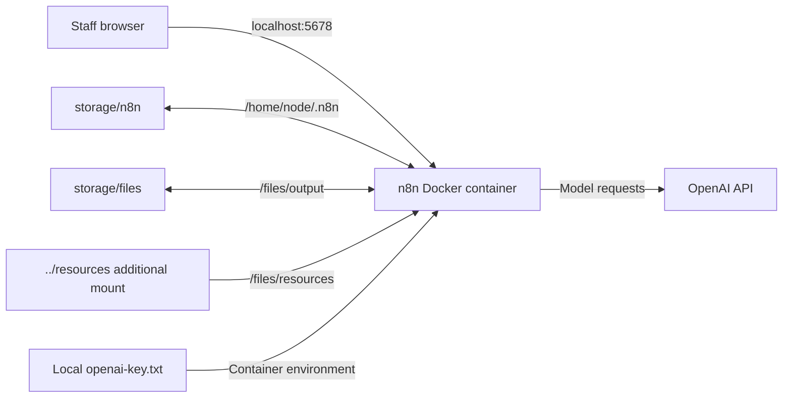

The port is published on `127.0.0.1`. Bind mounts preserve n8n configuration and workflow state outside the container. Deleting the container does not itself delete those host folders. They must still be protected and backed up, including configuration needed to decrypt saved credentials.

The current workflow reads CSV and PDF fixtures from `/files/output/resource/`, corresponding to `storage/files/resource/`, and writes artifacts to `/files/output/outbox/`. The additional `/files/resources` mount is not the source path used by those workflow nodes. Ignored local storage is not supplied by a Git clone.

### 1.3 Workflow routing

The screenshot below shows the workflow in the n8n editor. Open the image at full size to inspect individual nodes and connections.

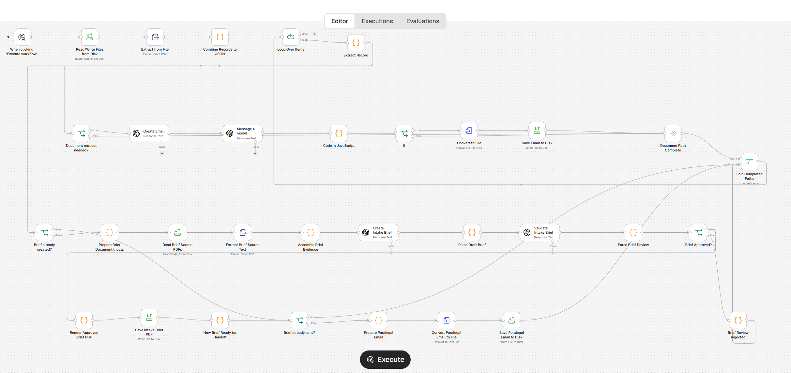

[View the full-size workflow screenshot](n8n.png).

The Mermaid diagram below summarizes the exported node connections. Node groups keep the routing readable alongside the editor screenshot.

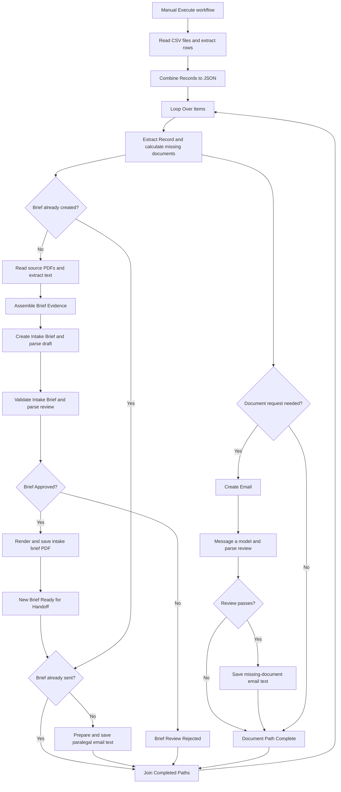

Both the document-request route and the brief route originate from the extracted intake record. The merge node rejoins routes before advancing the loop; the picture does not promise concurrent execution of external requests.

### 1.4 Logical input model

The CSV files are joined in JavaScript using `contact_id`, not database foreign keys. Duplicate or missing join keys and missing related records cause errors. Pipe-delimited document fields are converted into arrays, and literal `true`/`false` strings are converted to booleans.

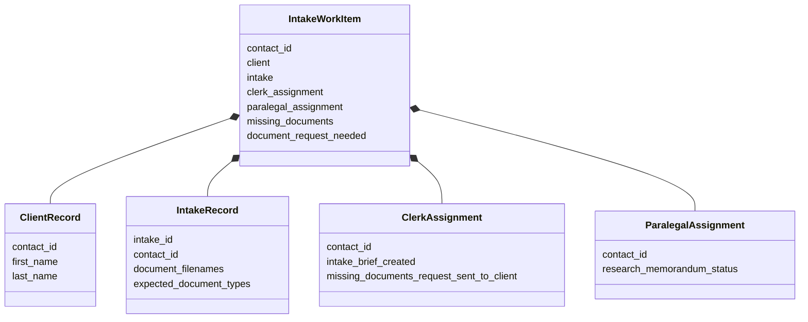

These are conceptual record shapes implemented as JavaScript objects, not declared application classes. The missing-document check compares expected types with filenames after removing the intake prefix and `.pdf` suffix. Correct naming is therefore part of the fixture contract; a filename match does not prove document completeness or authenticity.

### 1.5 Brief generation sequence

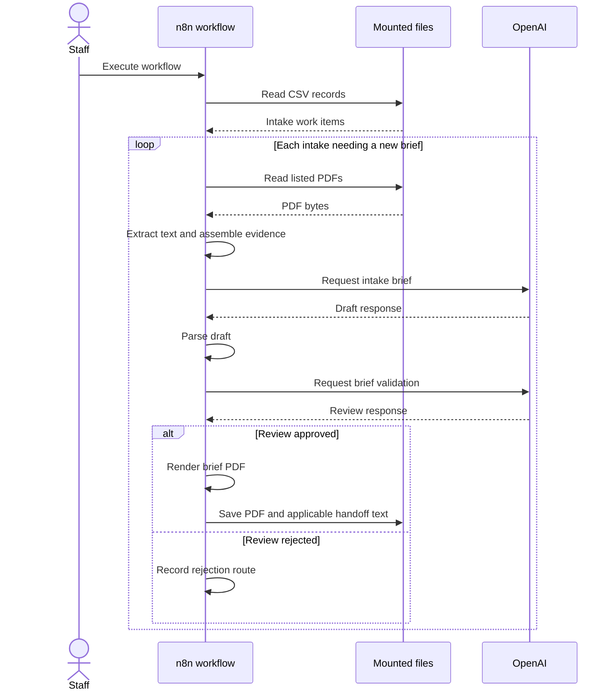

### 1.6 Outputs, failure handling, and tradeoffs

- Output artifacts include intake brief PDFs, missing-document email drafts, and paralegal handoff drafts in `storage/files/outbox/`.
- Status flags control skipping and handoff behavior. The workflow does not implement durable updates to the input CSV files or an external CRM, so reruns should not be assumed idempotent.
- The PDF renderer is local JavaScript and normalizes text to a limited character set. It avoids another rendering service but is not a general document-layout engine.
- Missing related records, unreadable files, model failures, or parse failures can interrupt execution. The explicit rejection route handles a rejected brief review; it is not a general exception recovery system.
- Environment access is enabled for the workflow's API-key expression. Credentials, n8n storage, and execution data belong outside source control. Production use would require access controls, audit policy, durable work state, and domain-approved review criteria.

## 2. Java / Spring Boot: Research memorandum preparation

### 2.1 Architecture and API contract

The application uses Spring MVC, Spring Security, Spring JDBC, Spring AI, SQLite, and PDFBox. A synchronous `POST /api/memorandums/prepare` starts work for the authenticated staff member. HTTP Basic authentication and the `MEMORANDUM_PREPARER` authority guard the endpoint. No body supplies a staff identity; work selection derives identity from Spring Security's context.

The response is a completion summary rather than a PDF or background-job receipt. Files are stored locally under the configured `memorandum.output-directory`, defaulting to `output/memorandums`.

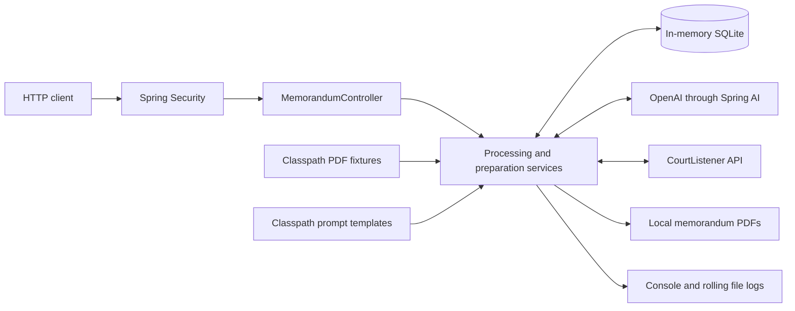

### 2.2 Service responsibilities and dependencies

Work selection is separated from preparation. The preparation service accepts selected `CaseDetails` and coordinates the stages; it does not establish the caller's identity or repeat authorization rules. Prompt templates live in `src/main/resources/prompts/`.

### 2.3 Relational model

The schema below is shared in structure with the notebook fixtures, but the databases are separate. Attributes shown are selected fields from the actual SQL schema. Sensitive fields exist in the fictional database but are not necessary in this diagram.

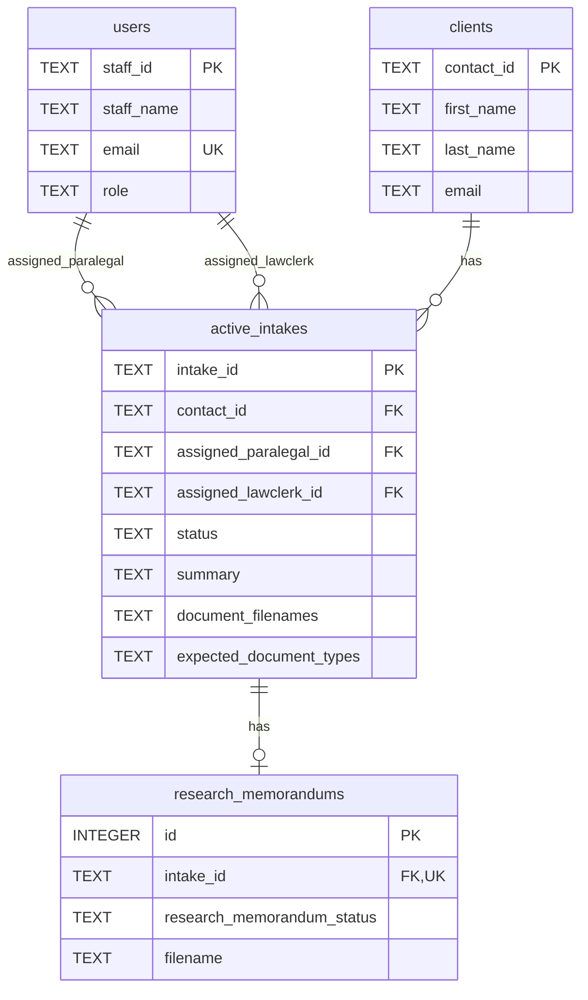

Each intake requires a client and two staff assignments. A unique `intake_id` in `research_memorandums` permits at most one memorandum row per intake. Status is constrained to `requested` or `completed` when non-null. Document lists remain delimited text fields rather than normalized document tables.

SQLite is seeded from `schema.sql` and `data.sql` at startup. A single pooled physical connection preserves the in-memory database for the application lifetime. Restarting resets database state but does not remove output PDFs.

### 2.4 End-to-end sequence

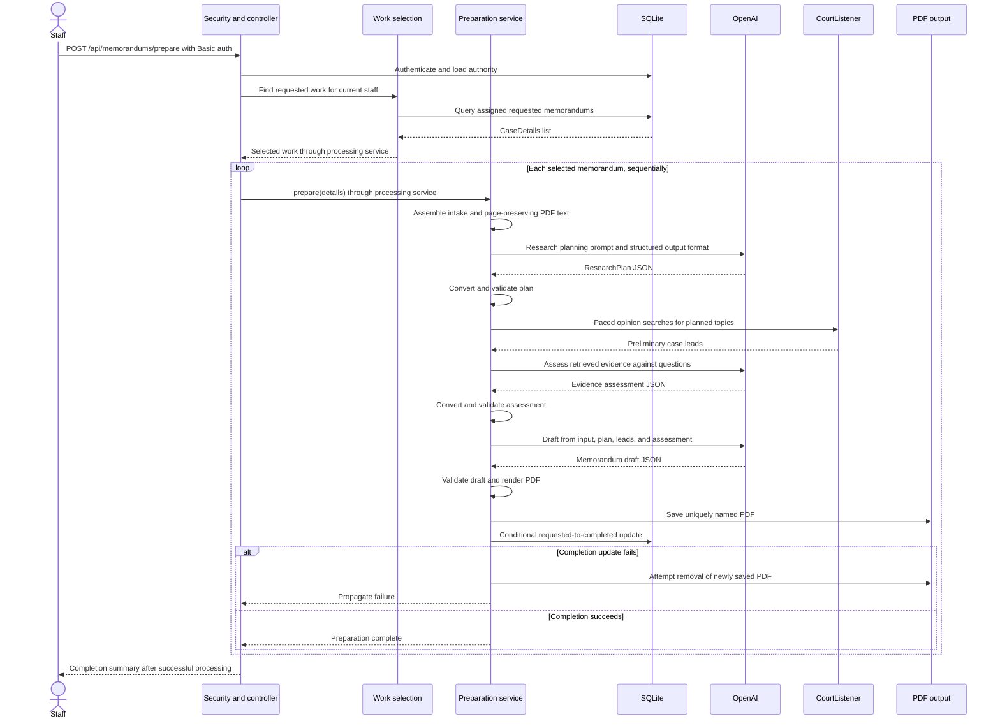

The controller delegates the loop to `MemorandumProcessingService`; the sequence groups those entry-point interactions to keep external processing visible. On failure, the successful-summary path is not taken. Earlier completed memorandums are not rolled back if a later one fails.

### 2.5 Evidence contracts and validation

`CaseInput` combines case details, extracted documents, and missing filenames. Documents carry source identifiers and page records. `ResearchPlan` contains topics, questions, queries, and source-attributed facts. CourtListener result models retain retrieved lead information; evidence-assessment models relate research questions to those results. `MemorandumDraft` supplies structured content to the PDF renderer.

Unknown source IDs in planned facts fail validation. Missing or invalid page references warn and continue for the demo; a valid page number does not establish that the page supports the statement. CourtListener leads and AI assessments do not independently establish a holding, citation accuracy, or legal applicability.

The current configuration executes at most one planned query per topic, retrieves at most five results per search, and spaces requests by 13 seconds in this JVM. These are demo limits, not guarantees about account-wide rate-limit compliance. PDF extraction reads embedded text and does not perform OCR.

### 2.6 Completion, observability, and deployment tradeoffs

The output PDF is saved before the database update. Completion uses memorandum ID, intake ID, and `requested` status as conditions. If that update fails, preparation attempts to remove the newly written file and propagates the failure, preserving cleanup failures as suppressed exceptions. Filesystem and database writes are not one atomic transaction; process crashes can still leave orphan files.

SLF4J writes to the console and a rolling log file. OpenAI prompt text and raw response JSON are logged separately for fictional-demo inspection. Shared external HTTP logging records bounded, sanitized transport metadata without bodies or credentials. Production handling would need an approved sensitive-data policy.

Synchronous processing keeps the demonstration easy to follow. A deployed service should use asynchronous jobs, persistent status, controlled retries, concurrency limits, and result retrieval. Those capabilities are proposals, not present endpoints. A persistent database and durable document storage would also be needed. The demo's plain-text seeded passwords and disabled CSRF protection are not suitable production defaults.

Tests cover authentication/authorization, repositories, case input, AI stages with mocked responses, research processing, and file/completion behavior. This design-document task did not run tests or issue live API calls.

## 3. Python / Jupyter: Memorandum review

### 3.1 Purpose and execution model

[legal-demo.ipynb](project/jupyter-notebook/summarize-docs-data/legal-demo.ipynb) is an interactive review workflow for an individual staff member. Cells run in order and share Python variables in the kernel. The implementation uses functions from libraries and dictionaries/lists; it does not define an application class hierarchy.

The notebook compares each memorandum with its own intake record and supporting PDFs. It asks for discrepancies, missing information, unsupported conclusions, and recommended revisions, then displays and exports the returned reviews. It does not search CourtListener or independently verify legal authorities.

### 3.2 Data flow and relational inputs

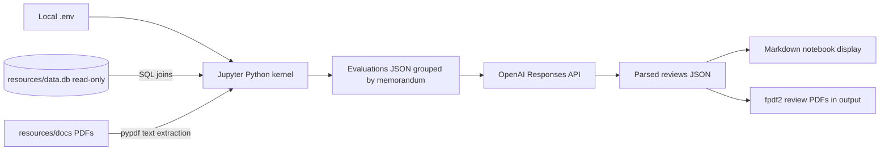

The local database uses the four-table ER model in Section 2.3. The query starts from `research_memorandums` and uses left joins to intake, client, and two staff aliases, preserving memorandum rows when a join does not match. It excludes passwords and client SSNs from the selected fields. The database connection uses SQLite read-only URI mode and closes in `finally`.

This is a separate fixture database, not a connection to the Java process's in-memory SQLite database. Memorandum filenames in the notebook database must match PDFs supplied in the notebook's `resources/docs` folder. Any transfer of Java outputs and corresponding fixture updates is manual.

### 3.3 Payload and response contracts

The following UML diagram describes JSON/data shapes rather than Python classes.

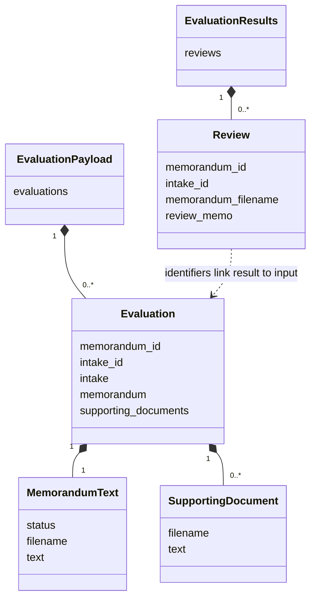

Supporting-document filenames come from each intake's pipe-delimited list. Each evaluation includes only that intake's listed evidence, even though the extraction cell reads all PDFs in the document directory. Missing dictionary entries raise `KeyError`. A convenience cell also assumes the first two memorandum filenames have matching extracted text.

### 3.4 Review sequence

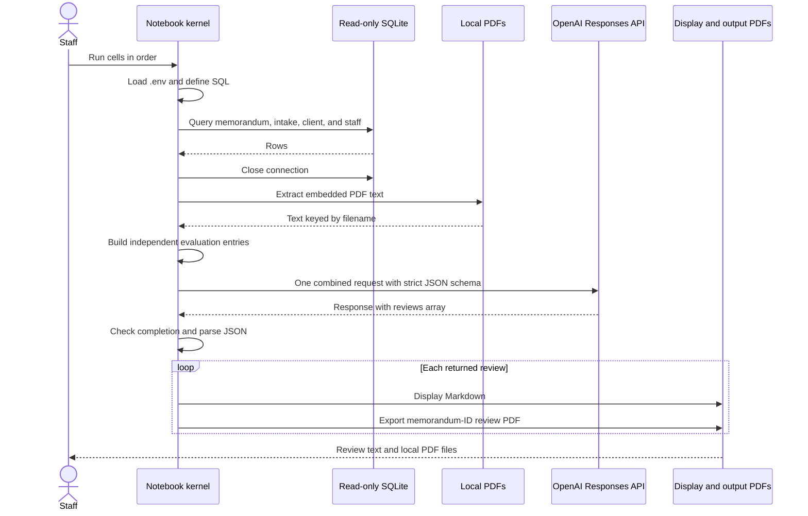

### 3.5 Review instructions and validation boundaries

The prompt requires independent evaluation of each entry and distinguishes documented evidence, client reports, allegations, assumptions, and conclusions. Source text is treated as material to assess rather than instructions. Findings should identify source filenames or intake fields, preserve conflicts, and avoid invented facts, page numbers, and authorities.

The request uses `gpt-4.1`, a strict JSON schema, a 12,000-token output limit, and `store=False`. The latter is a request storage setting, not a blanket claim about provider retention. The notebook checks response completion and parses JSON. The schema constrains output shape, but the current code does not establish that every input has exactly one correctly matched review or that the review is accurate.

### 3.6 Output and operating limitations

The notebook renders review text as Markdown for display. The PDF exporter writes the same text literally using `fpdf2`, so Markdown markers can remain visible. Files are named `memorandum-<id>-review.pdf`; subsequent runs overwrite matching files.

Paths currently assume `D:\lawfirm-intake-project`, and PDF export uses Windows Arial at `C:\Windows\Fonts\arial.ttf`. Portability requires path and font changes. Dependencies include `python-dotenv`, `pypdf`, `openai`, and `fpdf2`, alongside Jupyter.

The combined API request sends all assembled evaluation entries together. Large fixture sets can exceed practical context or output limits; batching, explicit input/output ID reconciliation, durable review status, and stronger export formatting would be future improvements. The notebook is an interactive prototype, without service authentication, background jobs, or an automated integration with the other demos.

An AI-generated review is another aid for human inspection, not independent legal verification. The final review responsibility remains with qualified staff and the supervising attorney.
