<!--
File: DESIGN.md
Author: James Brannan
Date: 2026-11-23
Description: Architecture, data models, and execution design of the three law firm demonstrations.
Copyright (c) 2026 James Brannan.
Licensed under the MIT License. See LICENSE in the repository root for the full terms.
SPDX-License-Identifier: MIT
-->

# Law Firm Workflow Demonstrations — Design

This document describes the implemented demonstrations as inspected on November 24, 2026. The three major sections follow intake preparation, preliminary research, and memorandum review. Each project runs independently with its own fixtures; their relationship is a business workflow, not an implemented automated integration.

Diagrams render on GitHub. Class and sequence diagrams use UML notation; flowcharts describe workflow routing, and ER diagrams describe relational structure. Class diagrams show selected responsibilities and dependencies rather than every accessor or model field.

All case material is fictional. These prototypes demonstrate software engineering approaches, not validated legal procedures. The author does not have professional legal domain expertise; workflow assumptions and legal outputs require validation with attorneys and law firm staff.

## Contents

- [n8n: Intake preparation](#1-n8n-intake-preparation)
- [Java / Spring Boot: Research memorandum preparation](#2-java--spring-boot-research-memorandum-preparation)
- [Python / Jupyter: Memorandum review](#3-python--jupyter-memorandum-review)
- [Failure handling across the demonstrations](#4-failure-handling-across-the-demonstrations)

Documentation uses Markdown with diagrams. Postman is the demonstration HTTP client, rather than an application dependency. Sequence diagrams simplify the main execution path and show selected failure branches; they do not enumerate every conditional call or exception.

## 1. n8n: Intake preparation

### 1.1 Purpose and boundaries

The workflow prepares intake material for staff review. It combines CSV records, checks for missing documents, extracts PDF text, creates an intake brief, and drafts missing-document and handoff messages. Email artifacts are saved to disk rather than transmitted. A separate AI review gates newly generated brief PDFs; an AI approval is not attorney approval.

The executable definition is [My workflow.json](project/n8n_work/My%20workflow.json). Deployment is defined by [compose.yml](project/n8n_work/compose.yml).

### 1.2 Deployment and storage

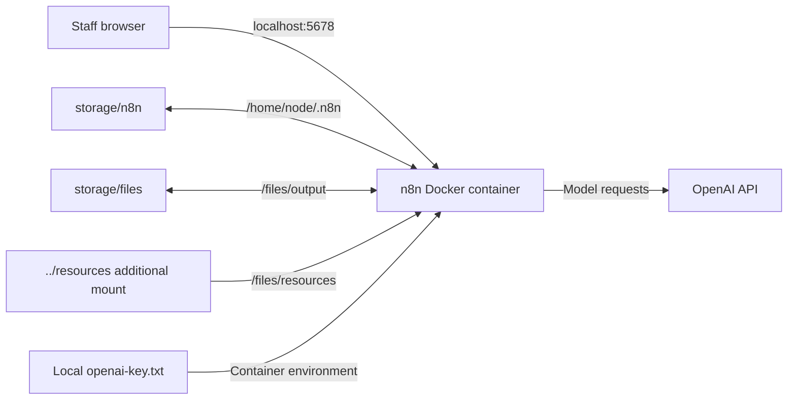

The port is published on `127.0.0.1`. Bind mounts preserve n8n configuration and workflow state outside the container. Deleting the container does not itself delete those host folders. They must still be protected and backed up, including configuration needed to decrypt saved credentials.

The current workflow reads CSV and PDF fixtures from `/files/output/resource/`, corresponding to `storage/files/resource/`, and writes artifacts to `/files/output/outbox/`. The additional `/files/resources` mount is not the source path used by those workflow nodes. The repository includes the fictional CSV and PDF fixtures and some generated example outputs. Local n8n configuration, saved credentials, and execution state under `storage/n8n/` are excluded from Git.

#### Technologies and packages

| Technology or package | Role |
| --- | --- |
| Docker Desktop and Docker Compose | Local container execution and bind-mount configuration |
| `n8nio/n8n:latest` | n8n runtime image; the tag does not pin a reproducible version |
| `n8n-nodes-base` | Manual trigger, file reading/writing, CSV/PDF extraction, JavaScript execution, conditions, looping, merging, and text-file conversion |
| n8n OpenAI nodes and OpenAI API | Drafting and reviewing missing-document emails and intake briefs |
| JavaScript and Node.js `Buffer` | Record joining, validation, handoff-message assembly, and local PDF generation |
| CSV, JSON, PDF, and plain text | Input records, exchanged data, source/generated documents, and saved email drafts |

The four OpenAI nodes are configured with `chat-latest`. This is a configured model identifier, not a guarantee of access for another API project. The exported nodes reference a saved n8n OpenAI credential. Compose loads `OPENAI_API_KEY` into the container, but that environment variable does not automatically configure the nodes' selected credentials. No API-key environment expression is present in the exported workflow.

### 1.3 Workflow routing

The screenshot below shows the workflow in the n8n editor. Open the image at full size to inspect individual nodes and connections.


[View the full-size workflow screenshot](n8n.png).

The diagram below summarizes the exported node connections. Node groups keep the routing readable alongside the editor screenshot.

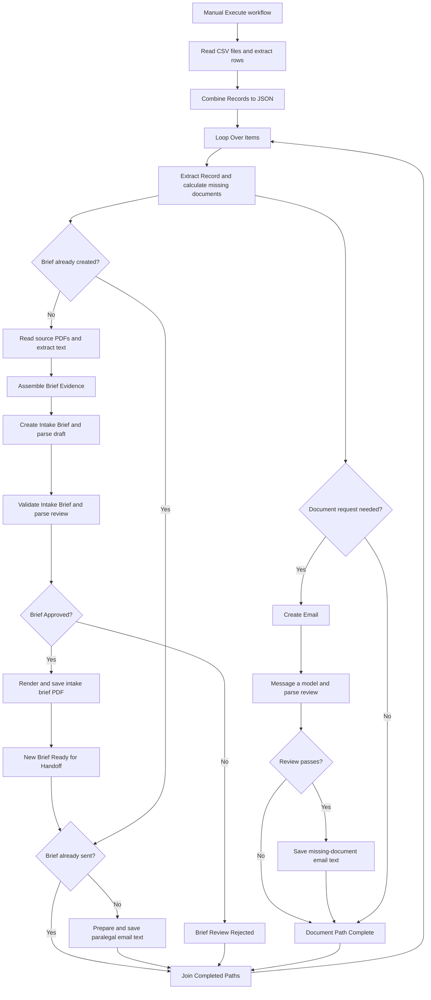

Both the document-request route and the brief route originate from the extracted intake record. The merge node rejoins routes before advancing the loop; the picture does not promise concurrent execution of external requests.

### 1.4 Logical input model

The CSV files are joined in JavaScript using `contact_id`, not database foreign keys. Duplicate or missing join keys and missing related records cause errors. Pipe-delimited document fields are converted into arrays, and literal `true`/`false` strings are converted to booleans.

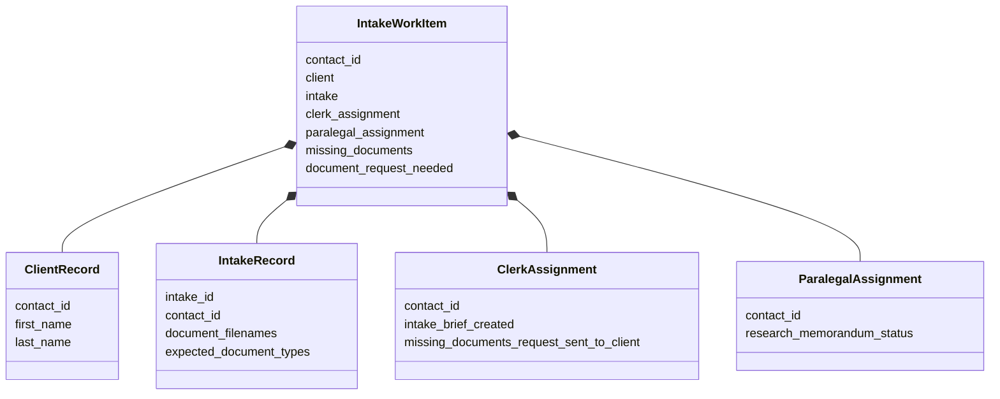

These are conceptual record shapes implemented as JavaScript objects, not declared application classes. Each input table accepts at most one record per `contact_id`, with duplicates rejected. This fixture model does not support multiple simultaneous intake records for the same client in one run. The missing-document check compares expected types with filenames after removing the intake prefix and `.pdf` suffix. Correct naming is therefore part of the fixture contract; a filename match does not prove document completeness or authenticity.

### 1.5 Brief generation sequence

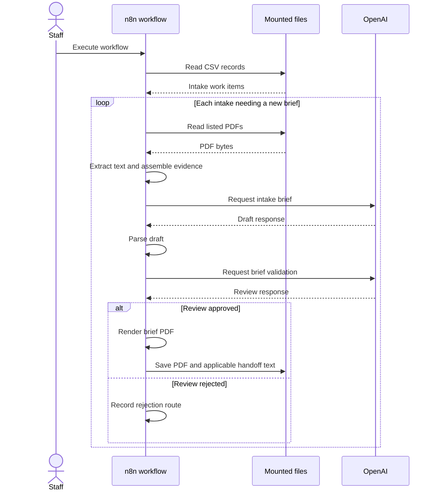

Before AI review, JavaScript checks required draft fields, client/intake/staff identities, received-document coverage, the missing-document list, hearing-source filenames, and prohibited identifiers. These checks enforce selected structural and consistency rules; they do not establish factual accuracy. The AI review receives both the evidence and the deterministic issues, and any deterministic issue prevents approval.

Missing-document emails follow their own drafting, AI review, parsing, and approval route before saving. Paralegal handoff emails are assembled from record fields in JavaScript rather than generated by AI.

### 1.6 Outputs, failure handling, and tradeoffs

- Output artifacts include intake brief PDFs, missing-document email drafts, and paralegal handoff drafts in `storage/files/outbox/`.
- Status flags control skipping and handoff behavior. The workflow does not implement durable updates to the input CSV files or an external CRM, so reruns should not be assumed idempotent.
- The PDF renderer is local JavaScript and normalizes text to a limited character set. It avoids another rendering service but is not a general document-layout engine.
- Missing related records, unreadable files, model failures, or parse failures can interrupt execution. The explicit rejection route handles a rejected brief review; it is not a general exception recovery system.
- Environment access is enabled in Compose, but the exported OpenAI nodes use saved credentials rather than an API-key expression. Credentials, n8n storage, and execution data belong outside source control. Production use would require access controls, audit policy, durable work state, and domain-approved review criteria.

## 2. Java / Spring Boot: Research memorandum preparation

### 2.1 Architecture and API contract

The application uses Spring MVC, Spring Security, Spring JDBC, Spring AI, SQLite, and PDFBox. A synchronous `POST /api/memorandums/prepare` starts work for the authenticated staff member. HTTP Basic authentication and the `MEMORANDUM_PREPARER` authority guard the endpoint. No body supplies a staff identity; work selection derives identity from Spring Security's context.

The response is a completion summary rather than a PDF or background-job receipt. Files are stored locally under the configured `memorandum.output-directory`, defaulting to `output/memorandums`.

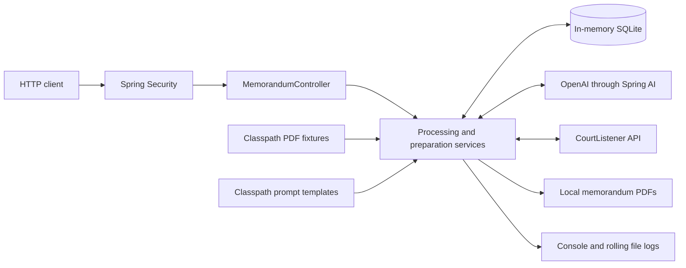

#### Technologies and dependencies

| Technology or library | Role |
| --- | --- |
| Java 17 and Maven | Language target, dependency management, build, and local execution |
| Spring Boot 4.1.2 and Spring MVC | Application configuration, embedded web application, and REST endpoint |
| Spring Security | HTTP Basic authentication, JDBC user lookup, and authority checks |
| Spring JDBC and HikariCP | Parameterized database access and the single-connection pool |
| SQLite and Xerial SQLite JDBC 3.51.0.0 | In-memory relational database and JDBC driver |
| Spring AI 2.0.1 | OpenAI integration, `ChatClient`, and `BeanOutputConverter` |
| Jackson | JSON serialization, mapping, and field annotations |
| Apache PDFBox 3.0.7 | PDF text extraction and memorandum rendering |
| Spring `RestClient`, JDK `HttpClient`, and `JdkClientHttpRequestFactory` | CourtListener HTTP requests |
| Spring AI OpenAI transport using OkHttp | OpenAI requests and per-attempt HTTP metadata interception |
| SLF4J and Logback | Application logging, console output, and rolling log files |
| OpenAI and CourtListener APIs | AI processing and preliminary opinion-search results |

The Maven project declares `spring-boot-starter-webmvc`, `spring-boot-starter-jdbc`, `spring-boot-starter-security`, `org.xerial:sqlite-jdbc`, `spring-ai-starter-model-openai`, and `org.apache.pdfbox:pdfbox`. The `spring-ai-bom` manages Spring AI versions, and `spring-boot-maven-plugin` supports packaging and execution. Supporting libraries such as HikariCP, Jackson, SLF4J, Logback, and OkHttp are supplied through the dependency stack rather than separate application declarations.

Test dependencies are `spring-boot-starter-webmvc-test` and `spring-security-test`. Tests use JUnit Jupiter, Mockito, AssertJ, Spring test utilities and MockMvc, and Logback test appenders. Versions not explicitly pinned here are managed by the Maven dependency configuration.

The configured OpenAI model is `gpt-6.2-sol`; availability depends on the API project. This document records configuration rather than promising model access.

#### Response contract

No request body is required. Successful processing returns `status: "completed"` with a `memorandums` array. For example, a request that completes one selected memorandum returns:

```json
{
  "status": "completed",
  "memorandums": [
    {"memorandumId": 1, "intakeId": "I-204", "status": "created"}
  ]
}
```

No eligible assignments returns `{"status":"no_work","memorandums":[]}`. Missing or invalid credentials produce HTTP 401; an authenticated caller without the required authority receives HTTP 403. Processing failures propagate rather than producing a successful completion summary; the application does not define a custom, stable error-response contract. Earlier completed memorandums remain completed if a later memorandum fails.

### 2.2 Security design and demo decisions

Security is implemented in [SecurityConfig.java](project/spring-boot-work/legal-research/src/main/java/com/demo/legalfirm/config/SecurityConfig.java). The demo retains authentication and permission checks while simplifying credential management and browser-request defenses for direct local execution with Postman.

| Concern | Implemented behavior | Design decision and boundary |
| --- | --- | --- |
| Authentication | HTTP Basic backed by `JdbcUserDetailsManager`; email identifies the seeded user | An inspectable authentication path without an identity-provider integration |
| Password verification | A delegating encoder receives seeded passwords prefixed with `{noop}` | Fictional demo credentials are plain text; this does not provide password hashing |
| Endpoint permission | `/api/memorandums/**` requires the exact `MEMORANDUM_PREPARER` authority; other requests require authentication | Successful login alone does not grant memorandum preparation access |
| Work selection | The security context supplies the user's email; a parameterized query filters requested work by the assigned paralegal/requestor email | The request body cannot supply another staff identity; this is the demo's assignment convention |
| Session management | `SessionCreationPolicy.STATELESS` | Authentication does not create a server-side login session; callers supply credentials on requests |
| CORS | Credentialed browser requests from HTTP/HTTPS `localhost` origins on any port; POST and an explicit header list on memorandum routes | Illustrates a separate local GUI; it is an origin policy, not a network binding or caller-IP restriction |
| CSRF | Disabled globally in the security filter chain | Deliberate simplification for direct Postman POST requests without a CSRF-token exchange |

#### Why CSRF is disabled here

The controlled demonstration uses Postman with HTTP Basic and disables CSRF to avoid a token-exchange step. A deployed browser client would need a CSRF decision based on its actual authentication model. Stateless sessions and CORS do not remove CSRF exposure when a browser automatically resends credentials, including browser-managed Basic authentication. The configured CSRF header names do not provide protection while CSRF validation is disabled.

#### Request security sequence

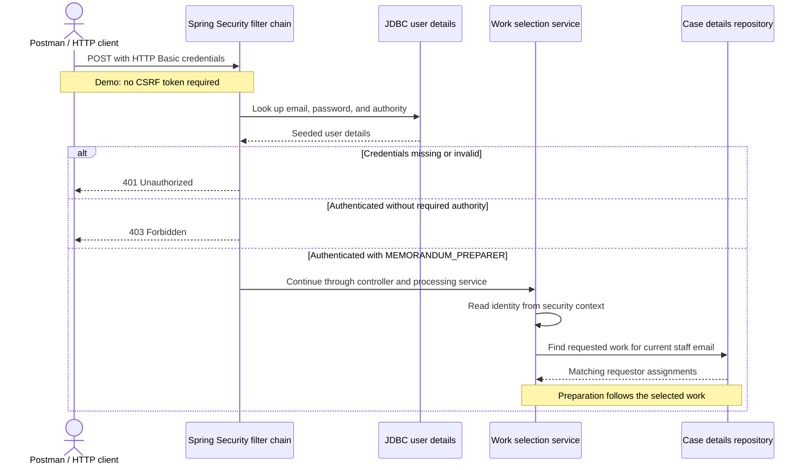

#### Verification and production boundary

The security integration tests cover missing/invalid credentials, seeded JDBC authentication, denied roles, absence of an authentication session, approved and rejected CORS origins, and required authentication even with an approved origin.

Before deployment, replace seeded plain-text credentials with a suitable identity and password-storage design, use HTTPS, select exact approved GUI origins, and decide CSRF handling from the actual client authentication model. CORS does not restrict the Java server to localhost. Production authorization would also need domain-approved assignment and access rules; the current requestor filter is not a complete law firm permissions model.

### 2.3 Service responsibilities and dependencies

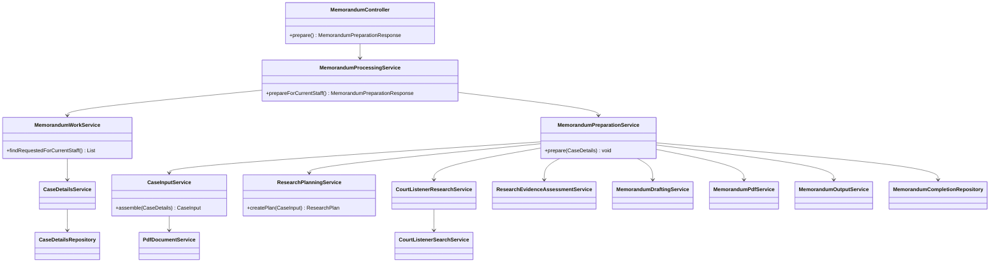

Work selection is separated from preparation. The preparation service accepts selected `CaseDetails` and coordinates the stages; it does not establish the caller's identity or repeat authorization rules. Prompt templates live in `src/main/resources/prompts/`.

### 2.4 Relational model

The diagram below describes the Java SQL schema. The notebook fixture schema has the same table definitions and constraints, but the databases are separate. Attributes shown are selected fields from the actual SQL schema. Sensitive fields exist in the fictional database but are not necessary in this diagram.

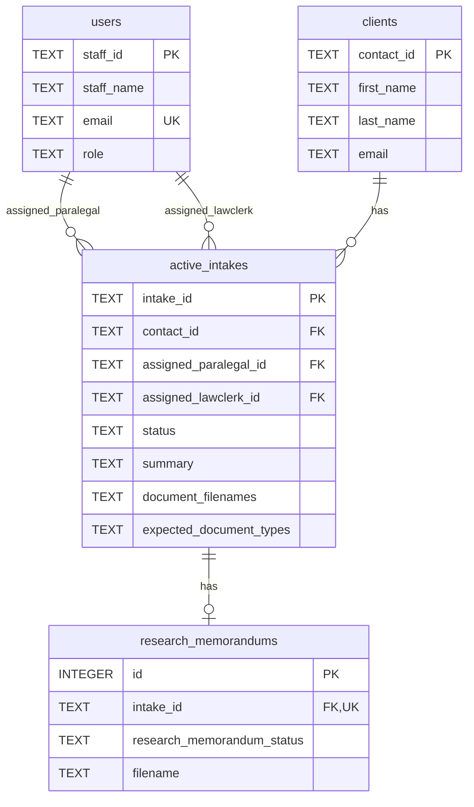

In the demo terminology, the assigned paralegal is the requestor whose email controls work selection; the assigned law clerk appears as preparer metadata. `MEMORANDUM_PREPARER` is an authorization value, not a job title. The current seed data grants that authority to Riley and Jordan, while only Riley is the requestor assigned to the two seeded intakes.

Each intake requires a client and two staff assignments. A unique `intake_id` in `research_memorandums` permits at most one memorandum row per intake. Status is constrained to `requested` or `completed` when non-null. Document lists remain delimited text fields rather than normalized document tables.

SQLite is seeded from `schema.sql` and `data.sql` at startup. A single pooled physical connection preserves the in-memory database for the application lifetime. Restarting resets database state but does not remove output PDFs.

### 2.5 End-to-end sequence

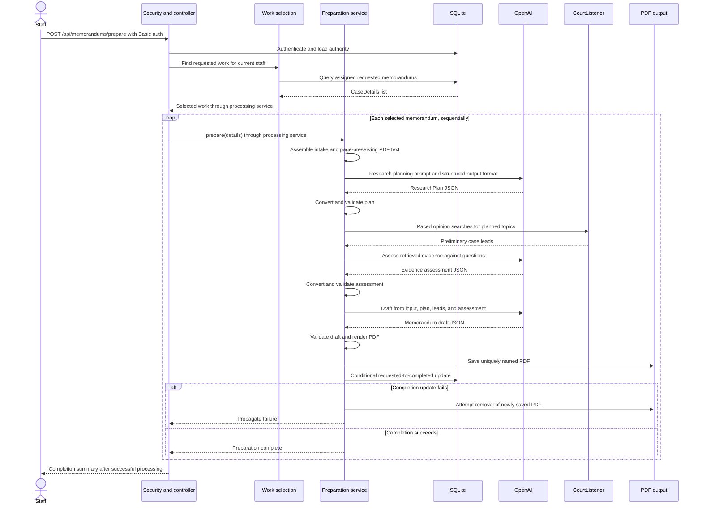

The controller delegates the loop to `MemorandumProcessingService`; the sequence groups those entry-point interactions to keep external processing visible. On failure, the successful-summary path is not taken. Earlier completed memorandums are not rolled back if a later one fails.

### 2.6 Evidence contracts and validation

`CaseInput` combines case details, extracted documents, and missing filenames. Documents carry source identifiers and page records. `ResearchPlan` contains topics, questions, queries, and source-attributed facts. CourtListener result models retain retrieved lead information; evidence-assessment models relate research questions to those results. `MemorandumDraft` supplies structured content to the PDF renderer.

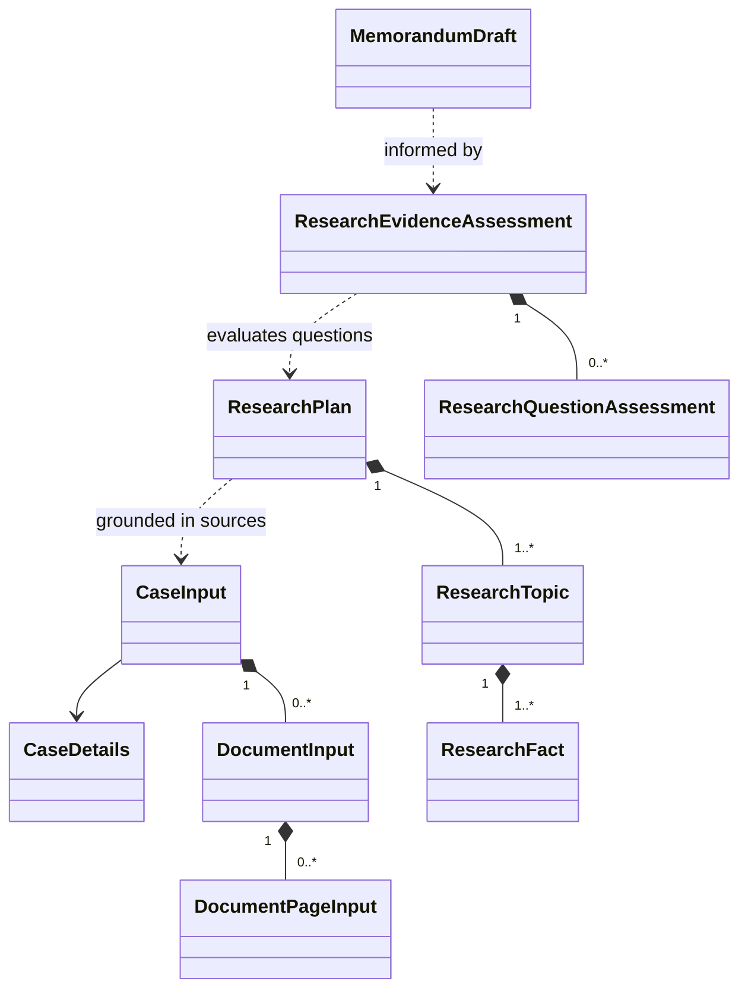

| AI stage | Inputs | Structured output |
| --- | --- | --- |
| Research planning | Case details and extracted document pages | `ResearchPlan` |
| Evidence assessment | Research plan and CourtListener results | `ResearchEvidenceAssessment` |
| Memorandum drafting | Case input, plan, results, and assessment | `MemorandumDraft` |

Spring AI's `BeanOutputConverter` supplies JSON-format instructions and converts response JSON into Java objects. Application checks then validate selected fields and references. This differs from the notebook's strict API-level JSON schema; format instructions and Java conversion alone do not establish semantic correctness. Research planning requires at least one topic. Although the assessment service handles an empty topic list defensively, the preparation workflow rejects such a plan during planning validation.

An absent local PDF is recorded by filename as a limitation and processing continues. An existing PDF that cannot be read or extracted raises a processing failure.

Unknown source IDs in planned facts fail validation. Missing or invalid page references warn and continue for the demo; a valid page number does not establish that the page supports the statement. CourtListener leads and AI assessments do not independently establish a holding, citation accuracy, or legal applicability.

The current configuration executes at most one planned query per topic, retrieves at most five results per search, and spaces requests by 13 seconds in this JVM. These are demo limits, not guarantees about account-wide rate-limit compliance. PDF extraction reads embedded text and does not perform OCR.

The OpenAI configuration sets `spring.ai.openai.timeout=120s` and `spring.ai.openai.max-retries=2`. CourtListener uses a 10-second connection timeout and a 30-second read timeout, without an application retry loop. Its 13-second pacing controls search spacing, not retries. These settings are not a complete recovery policy or a guarantee of total endpoint duration across AI stages, searches, and transport attempts.

### 2.7 Completion, observability, and deployment tradeoffs

The output PDF is saved before the database update. Completion uses memorandum ID, intake ID, and `requested` status as conditions. If that update fails, preparation attempts to remove the newly written file and propagates the failure, preserving cleanup failures as suppressed exceptions. Filesystem and database writes are not one atomic transaction; process crashes can still leave orphan files.

SLF4J application logging uses Logback to write to the console and `logs/researchmemorandum.log`, with 10 MB rolling files, seven days of history, and a 70 MB total archive cap. OpenAI prompt text and raw response JSON are logged separately for fictional-demo inspection. Shared external HTTP logging records bounded, sanitized transport metadata without bodies or credentials. Production handling would need an approved sensitive-data policy.

Synchronous processing keeps the demonstration easy to follow. A deployed service should use asynchronous jobs, persistent status, controlled retries, concurrency limits, and result retrieval. Those capabilities are proposals, not present endpoints. A persistent database and durable document storage would also be needed. The demo's plain-text seeded passwords and disabled CSRF protection are not suitable production defaults.

Tests cover authentication/authorization, repositories, case input, AI stages with mocked responses, research processing, and file/completion behavior.

## 3. Python / Jupyter: Memorandum review

### 3.1 Purpose and execution model

[legal-demo.ipynb](project/jupyter-notebook/summarize-docs-data/legal-demo.ipynb) is an interactive review workflow for an individual staff member. Cells run in order and share Python variables in the kernel. The implementation uses functions from libraries and dictionaries/lists; it does not define an application class hierarchy.

The notebook compares each memorandum with its own intake record and supporting PDFs. It asks for discrepancies, missing information, unsupported conclusions, and recommended revisions, then displays and exports the returned reviews. It does not search CourtListener or independently verify legal authorities.

#### Technologies and packages

| Technology or package | Role |
| --- | --- |
| Python | Notebook execution language |
| JupyterLab and IPython | Interactive workspace, shared kernel state, and `IPython.display` Markdown rendering |
| `python-dotenv` | Loading the local `.env` file |
| `pypdf` | Extracting embedded text from PDFs |
| `openai` | OpenAI Python SDK and Responses API requests |
| `fpdf2` | Exporting review text as PDFs; imported as `fpdf` |
| Standard-library `sqlite3`, `json`, and `pathlib` | Read-only database access, JSON handling, and filesystem paths |
| SQLite, SQL, JSON, Markdown, PDF, and Windows Arial | Fixture storage, queries, payloads, displayed reviews, and exported documents |

The notebook metadata records Python 3.11.4, but does not enforce that version or pin third-party package versions. A fresh installation may differ from the recorded environment. The configured model is `gpt-4.1`; the API project must have access to it.

### 3.2 Data flow and relational inputs

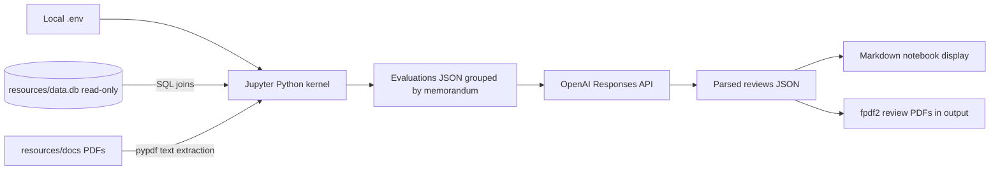

The local database uses the four-table ER model in Section 2.4. The query starts from `research_memorandums` and uses left joins to intake, client, and two staff aliases, preserving memorandum rows when a join does not match. It excludes passwords and client SSNs from the selected fields. The database connection uses SQLite read-only URI mode and closes in `finally`.

This is a separate fixture database, not a connection to the Java process's in-memory SQLite database. Memorandum filenames in the notebook database must match PDFs supplied in the notebook's `resources/docs` folder. Any transfer of Java outputs and corresponding fixture updates is manual.

### 3.3 Payload and response contracts

The following UML diagram describes JSON/data shapes rather than Python classes.

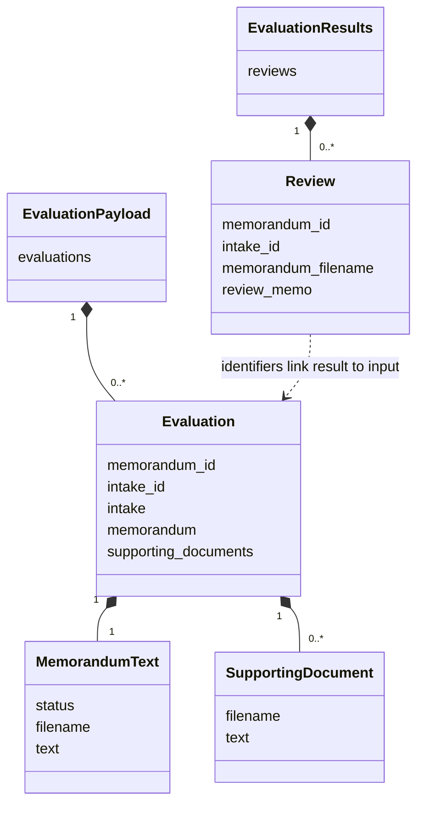

Supporting-document filenames come from each intake's pipe-delimited list. Each evaluation includes only that intake's listed evidence, even though the extraction cell reads all PDFs in the document directory. Missing dictionary entries raise `KeyError`. A convenience cell also assumes the first two memorandum filenames have matching extracted text.

### 3.4 Review sequence

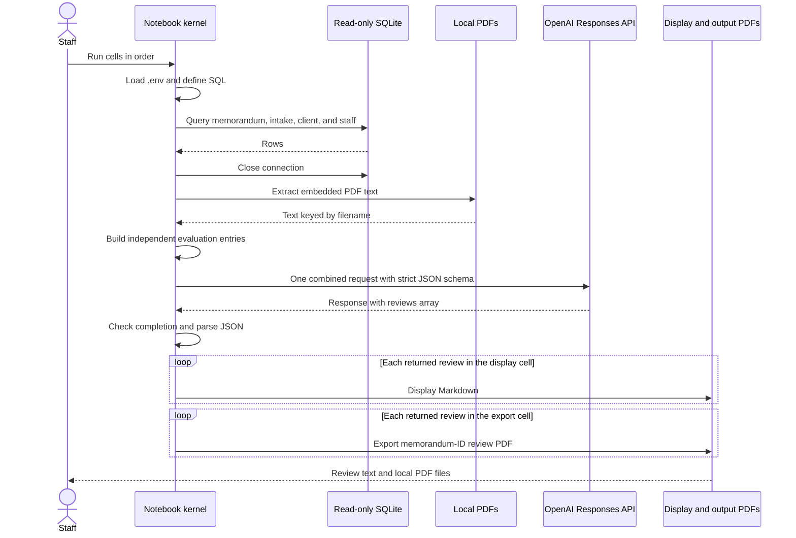

### 3.5 Review instructions and validation boundaries

The prompt requires independent evaluation of each entry and distinguishes documented evidence, client reports, allegations, assumptions, and conclusions. The prompt instructs the model to treat source text as material to assess rather than instructions. Findings should identify source filenames or intake fields, preserve conflicts, and avoid invented facts, page numbers, and authorities.

The request uses `gpt-4.1`, a strict JSON schema, a 12,000-token output limit, and `store=False`. The latter is a request storage setting, not a blanket claim about provider retention. The notebook checks response completion and parses JSON. The schema constrains output shape, but the current code does not establish that every input has exactly one correctly matched review or that the review is accurate.

### 3.6 Output and operating limitations

The notebook renders review text as Markdown for display. The PDF exporter writes the same text literally using `fpdf2`, so Markdown markers can remain visible. Files are named `memorandum-<id>-review.pdf`; subsequent runs overwrite matching files.

Paths currently assume `D:\lawfirm-intake-project`, and PDF export uses Windows Arial at `C:\Windows\Fonts\arial.ttf`. Portability requires path and font changes. Dependencies include `python-dotenv`, `pypdf`, `openai`, and `fpdf2`, alongside Jupyter.

The combined API request sends all assembled evaluation entries together. Large fixture sets can exceed practical context or output limits; batching, explicit input/output ID reconciliation, durable review status, and stronger export formatting would be future improvements. The notebook is an interactive prototype, without service authentication, background jobs, or an automated integration with the other demos.

An AI-generated review is another aid for human inspection, not independent legal verification. The final review responsibility remains with qualified staff and the supervising attorney.

## 4. Failure handling across the demonstrations

| Demonstration | Implemented behavior | Boundary |
| --- | --- | --- |
| n8n | Review rejection follows explicit routes; malformed records, unreadable files, model failures, and parse errors can interrupt execution | No general recovery workflow or durable assignment-state update; reruns can overwrite named outputs |
| Java | Exceptions propagate; a failed completion update triggers attempted cleanup of its newly saved PDF | Earlier completed work remains; cleanup can fail, crashes can leave orphan files, and concurrent requests do not reserve work before processing |
| Python notebook | Missing files, missing dictionary entries, incomplete responses, and parse/export failures raise exceptions | Staff must inspect the failure and rerun appropriate cells; shared kernel variables can retain earlier results |

Across the demos, intake and document material included in prompts is transmitted to OpenAI. The Java application sends generated research queries to CourtListener. A read-only notebook database prevents database writes through that connection; it does not keep selected content local. Local artifacts and logs also require appropriate handling. Error handling and retries are simplified for demonstration purposes; none of the demos implements a complete operational recovery system.
