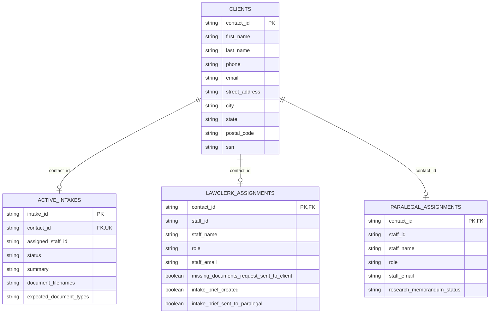

# Law Firm Intake Automation Demo

The demo starts with completed intake exports. One recurring scheduled process reads the intake records and runs client document follow-up and brief preparation/handoff in parallel. The demo assumes the assignee receives the brief when the workflow saves the handoff email.

The tables show the current fictional CSV exports. The entity diagram shows the current CSV schema. The two process diagrams use BPMN 2.0 notation; editable .bpmn models and SVG views are in project/diagrams. Email delivery is simulated through a local outbox.

## Sample data

Each table puts CSV fields down the left and one complete record in each of the other columns.

### `clients.csv`

The client records supply contact details. All four files join by `contact_id`.

| CSV field | C-101 | C-102 |
|---|---|---|
| `contact_id` | C-101 | C-102 |
| `first_name` | Elena | Mateo |
| `last_name` | Rivera | Santos |
| `phone` | 202-555-0101 | 202-555-0102 |
| `email` | elena.rivera@example.com | mateo.santos@example.com |
| `street_address` | 100 Sample Lane | 200 Sample Lane |
| `city` | Example City | Example City |
| `state` | MD | MD |
| `postal_code` | 00000 | 00000 |
| `ssn` | DEMO-SSN-101 | DEMO-SSN-102 |

### `active_intakes.csv`

The firm compares `document_filenames` with `expected_document_types` to determine what to request. A pipe separates values within each list.

| CSV field | I-204 | I-205 |
|---|---|---|
| `intake_id` | I-204 | I-205 |
| `contact_id` | C-101 | C-102 |
| `assigned_staff_id` | S-001 | S-002 |
| `status` | Ready for review | Ready for review |
| `summary` | Client requests help after receiving immigration court paperwork about an alleged overstay. She provided a Notice to Appear and a Notice of Hearing. The hearing notice lists December 15, 2026, at 9:00 a.m. Eastern Time. Documents are on file for review. | Client requests help understanding a USCIS receipt notice for his work-permit application. He also provided a Maryland reckless-driving citation and trial notice. The trial notice lists December 15, 2026, at 9:00 a.m. Eastern Time. Client reports that he has diabetes and experienced sudden confusion around the time of the driving incident. He disputes the officer’s account and says medical records and glucose-monitor data may be available. Those records have not been provided. Documents and client statements are ready for review. |
| `document_filenames` | I-204-notice-to-appear.pdf\|I-204-notice-of-hearing.pdf | I-205-uscis-receipt-notice.pdf\|I-205-maryland-uniform-traffic-citation.pdf\|I-205-maryland-district-court-trial-notice.pdf |
| `expected_document_types` | notice-to-appear\|notice-of-hearing | notice-to-appear\|notice-of-hearing\|uscis-receipt-notice\|maryland-uniform-traffic-citation\|maryland-district-court-trial-notice |

Elena has both documents on her expected checklist: the Notice to Appear and the immigration Notice of Hearing. No USCIS receipt notice is expected because this scenario does not establish a separate USCIS application. Mateo is missing the immigration Notice to Appear and Notice of Hearing from his fictional checklist. Mateo also expects the USCIS Receipt Notice, Maryland traffic citation, and trial notice, and all three are already received.

### Mateo's received Maryland documents

| Document type | Sample PDF in resources | Delivery represented in the sample |
|---|---|---|
| maryland-uniform-traffic-citation | I-205-maryland-uniform-traffic-citation.pdf | Issued and provided to Mateo on November 10, 2026. Mateo supplied a copy to the firm on November 17, 2026. |
| maryland-district-court-trial-notice | I-205-maryland-district-court-trial-notice.pdf | Issued and mailed to Mateo on November 13, 2026. Mateo received it and supplied a copy to the firm on November 17, 2026. |

Both samples identify Mateo Santos, intake I-205, citation DEMO-TR-205-001, and case DEMO-DC-205-001. They describe a reckless-driving allegation under Maryland Transportation Article section 21-901.1(a)(2), arising November 10, 2026 in Frederick County. The notice lists trial for December 15, 2026 at 9:00 a.m. Eastern Time at a fictional court facility. The PDFs are labeled fictional samples for demo use.

The intake lists three received PDFs and five expected document types. Every received PDF matches an expected type. All three received files exist in resources. The two outstanding immigration notices remain the items for client follow-up.

The medical account in summary is client-reported and awaits verification. Mateo identifies potential ambulance records, emergency-department records, and glucose-monitor data. Those records have yet to be supplied and are potential evidence for the future research demo. The current expected-document checklist contains the five document types shown above.

### `lawclerk_assignments.csv`

Each row identifies the clerk and tracks missing-document requests, brief creation, and handoff sending.

| CSV field | C-101 | C-102 |
|---|---|---|
| `contact_id` | C-101 | C-102 |
| `staff_id` | S-001 | S-002 |
| `staff_name` | Maya Chen | Doug Smith |
| `role` | law_clerk | law_clerk |
| `staff_email` | maya.chen@example.com | doug_smith@example.com |
| `intake_brief_created` | false | false |
| `missing_documents_request_sent_to_client` | false | false |
| `intake_brief_sent_to_paralegal` | false | false |

Both intakes start with intake_brief_created set to false, so Maya's intake for Elena and Doug's intake for Mateo both enter brief creation. Both clerk-side handoff sent flags also start false; after each brief is created and approved, save a handoff email to its assigned paralegal. Neither clerk has sent a missing-document request; Elena currently needs none. Doug is assigned to Mateo. The intake assigned_staff_id is S-002 and matches his staff_id in the clerk assignment CSV. Use the clerk assignment CSV for routing.

### `paralegal_assignments.csv`

Each row identifies the assigned paralegal and records research memorandum status. Brief handoff is tracked only by intake_brief_sent_to_paralegal in lawclerk_assignments.csv; no separate brief-received flag is used. Document receipt and expectations are recorded only in active_intakes.csv, using document_filenames and expected_document_types. The paralegal assignment CSV contains no document-receipt flags.

| CSV field | C-101 | C-102 |
|---|---|---|
| `contact_id` | C-101 | C-102 |
| `staff_id` | S-003 | S-004 |
| `staff_name` | Jordan Ellis | Riley Morgan |
| `role` | paralegal | paralegal |
| `staff_email` | jordan.ellis@example.com | riley.morgan@example.com |
| `research_memorandum_status` | not_requested | requested |

Jordan Ellis is assigned to Elena and Riley Morgan to Mateo. Both Elena's and Mateo's briefs are still to be created according to the starting CSV flags. The clerk-side sent flags start false for both intakes. The clerk-side sent flag controls whether to generate a handoff email; paralegal receipt of the brief is not tracked separately.

The research memorandum status is `not_requested` for Elena and `requested` for Mateo. These values record the request state; they do not indicate that research has been completed.

## Entity relationship diagram

The diagram shows the current CSV schema. PK and FK identify logical keys in the CSV model.

Each client can have one intake, one clerk assignment, and one paralegal assignment in this demo. Each link uses `contact_id`. Use `intake_id` to identify PDFs and outbox messages.

The assignment contact_id fields are logical primary and foreign keys. ACTIVE_INTAKES.contact_id is a unique foreign key; intake_id remains its primary key. For the same contact_id, ACTIVE_INTAKES.assigned_staff_id must match LAWCLERK_ASSIGNMENTS.staff_id. This is an assignment consistency rule, not a global uniqueness requirement for staff_id. CSV files do not enforce these logical constraints.

The intake records what the firm received from the client. The clerk assignment records what the clerk created or sent. The paralegal assignment identifies the recipient and tracks research memorandum status. The clerk assignment is the sole source of brief-sent status.

## Scheduled intake processing

active_intakes.csv contains only intakes currently requiring workflow monitoring. Inactive intakes are archived outside this file and excluded from scheduled processing. Archiving is handled separately and is outside this demo's scope. Completing a brief or handoff does not automatically make an intake inactive.

A recurring timer starts one intake process at a configurable interval. Read clients.csv, active_intakes.csv, lawclerk_assignments.csv, and paralegal_assignments.csv, join by contact_id, and use the same snapshot for both parallel branches. Staff assignments identify responsibility and recipients; no law-clerk start or manual clerk review is required for each run.

The BPMN timer start event launches processing and the read/join task creates the intake collection. A sequential multi-instance subprocess, Process each intake, runs once for every joined active-intake record. Inside each instance, a parallel gateway starts document follow-up and brief preparation/handoff for that one intake. Both branches complete, including normal skips when work is already done or unnecessary, and meet at the parallel join. Save that intake's status updates, then process the next intake. After all intakes are processed, the outer end event completes the scheduled run. The three horizontal lines on the expanded subprocess denote sequential multi-instance execution; the parallel gateways inside it apply only to its two branches.

### Parallel branch 1 | Client document follow-up

Compare expected_document_types with the document types in document_filenames to calculate missing_documents. Drafting and review prompts must use this calculated list as the sole source of missing-document requests. Do not infer additional missing or relevant documents from assignment data or suggest document-specific follow-up for types outside the expected checklist. When documents are missing and no request has already been sent, draft and agent-review one email using missing-documents-email-template.txt, save it in the local outbox, and record missing_documents_request_sent_to_client as true. Otherwise skip the request.

### Parallel branch 2 | Brief preparation and handoff

Use an existing intake brief when already created. Otherwise draft and agent-review a brief using intake-brief-template.txt, render the PDF, and record intake_brief_created as true. Include the calculated missing_documents list in the brief rather than waiting for document follow-up to finish. Use that list for checklist follow-up; an unreceived document outside expected_document_types is not a missing item. Distinguish other follow-up supported by the intake summary, such as Mateo's potential medical evidence, from checklist-missing documents.

Use the recipient recorded in paralegal_assignments.csv. Both demo intakes already have assignees. If intake_brief_sent_to_paralegal is true, complete the brief path without another handoff. Otherwise prepare a notification email and include the brief file path in its body, then save the email in the outbox. The demonstration uses a path instead of an attachment and does not update CSV files. The full workflow would set only the clerk-side intake_brief_sent_to_paralegal flag after a successful handoff; no separate brief-received flag is used.

### Parallel execution

Neither branch depends on the other's output. Missing documents do not block brief preparation. Both branches use the same intake snapshot. Merge their changed fields and serialize CSV writes so the updates are saved together.

Research memorandum creation remains a separate process triggered by research_memorandum_status = requested, not a third branch of scheduled intake processing.

## Demo simplifications

**CSV updates are skipped for the demonstration.** The workflow does not write status flags or research memorandum status changes back to any CSV file. This preserves the starting fixtures so the same scenarios can be demonstrated repeatedly. CSV writes and persisted status changes described elsewhere in this document and its diagrams represent the intended full workflow; they are omitted from the demonstration. Generated output files are still saved to storage. Because the CSV flags remain unchanged, repeating the demo can regenerate the same outputs.

The demo assumes successful execution. Errors and retries are not considered for simplicity. Redaction is not considered for simplicity. All client and case data is fictional.

## Running the demo

**Simulated sending.** Saving the handoff email with the brief file path in its body counts as sending for the demonstration. No attachment or separate receipt acknowledgment is used. The full workflow would update the clerk-side sent flag; the demonstration saves the output without updating CSV flags.

**AI roles.** The drafting agent uses the approved templates, intake summary, source documents, and calculated lists. The review agent checks requested items and the source of factual claims. Workflow code joins CSVs, addresses messages, renders PDFs, writes the outbox, and updates flags.

### What to show live

1. **Elena.** The scheduled run for Maya's assigned intake finds no missing documents and saves no document-request email. Her fictional Notice to Appear alleges that she entered as a B-2 visitor on March 1, 2025, was authorized to remain until August 31, 2025, and remained beyond that date without authorization. These are DHS allegations, not judicial findings. The hearing notice supplies the December 15, 2026 hearing details. The starting data records Elena's brief-created and clerk-side sent flags as false; there is no separate brief-received flag. Create and validate I-204-intake-brief.pdf, save the approved brief, and save a handoff email to Jordan. CSV flags remain unchanged for the demonstration.
2. **Mateo, scheduled intake run.** The document-follow-up branch for Doug's assigned intake requests the immigration Notice to Appear and Notice of Hearing. In parallel, the brief branch creates I-205-intake-brief.pdf and automatically saves a separate handoff email to Riley. Show the saved brief and handoff email; the request, brief-created, and brief-sent CSV flags remain unchanged for the demonstration. Both requested immigration documents are still outstanding. Mateo's traffic citation and trial notice are already on file. The intake brief includes his reckless-driving charge, the trial details from the notice, and the medical account attributed to him and awaiting verification.

3. **Mateo, research run.** Read requested from the assignee record, build the source-linked fact summary, research and verify authorities, draft and independently review the memorandum, then save the draft and source list and set draft_ready. Elena remains not_requested. Show research gaps and outstanding verification rather than presenting unsupported legal conclusions.

### Expected results

| Scenario | Expected result |
|---|---|
| Elena intake | No document request; create and validate one brief, save the approved brief, and save one handoff email to Jordan. |
| Mateo intake | One request for the two checklist items; one brief; one handoff to Riley. |
| Intake status updates | Request, brief-created, and brief-sent CSV flags remain unchanged for both intakes during the demonstration; no brief-received flag exists. |
| Research | Mateo changes from requested to draft_ready; Elena remains not_requested. |

### Fixture assumptions

The design assumes no more than 50 paralegals and no more than 10 active clients per paralegal, for a maximum of 500 active clients. At this scale, the workflow reads the four CSV files and joins their records into one in-memory collection, with one JSON object per active intake. The collection contains record fields and document filenames; PDF contents are loaded separately when needed.

Both sample intakes are active and remain in active_intakes.csv. The status field describes intake readiness; it does not determine archival eligibility.

Both clerk assignments start with intake_brief_created set to false. An example brief PDF already present in resources does not change that starting state; the CSV flag controls whether the workflow creates a brief. Generated briefs do not update the CSV flags for the demonstration.

Each client has one intake and one assignment per staff role shown. Both sample clients already have assignees. The checklists are fictional. Elena expects only the Notice to Appear and immigration Notice of Hearing, both received. Her scenario is an alleged overstay of authorized B-2 visitor admission; no separate USCIS application is established. Mateo retains his existing five-document checklist, including the two received Maryland traffic documents. The brief can cite details from listed source PDFs. The request decision uses the CSV comparison.

The clerk assignment CSV controls routing. Match each intake to that assignment by contact_id and confirm assigned_staff_id matches staff_id. Doug Smith (S-002) is assigned to Mateo and his email is doug_smith@example.com.

## Demo 2 | Internal legal research memorandum

This separate agentic process starts when research_memorandum_status is requested in paralegal_assignments.csv. The paralegal lane contains the human user task that records the research request; the Research automation lane contains the automated research and drafting tasks. Mateo starts as requested; Elena starts as not_requested. The research workflow is a design for the demo, not an implemented research service.

Use Mateo's intake notes and received USCIS receipt, traffic citation, and trial notice to prepare a draft internal legal research memorandum for paralegal review. Research the possible effect of the pending reckless-driving charge and potential dispositions on his employment authorization, and whether the reported diabetic episode is relevant to the traffic allegation. His underlying immigration matter and employment-authorization eligibility category are not established by the sample receipt; record that gap and make any dependent analysis conditional. Do not describe the receipt as a visa approval or treat diabetes as an established defense or entitlement to work authorization.

### Research memorandum creation flow

The BPMN service tasks proceed from document review through research, analysis, drafting, independent review, and saving the draft. The end event means the draft is ready for paralegal review, not that legal advice or a filing has been approved.

### Agent stages and working outputs

| Stage | Working output |
|---|---|
| Review source documents | Source-linked fact summary distinguishing documented information, allegations, client statements, and unknowns. Record only actions actually completed. |
| Plan the research | Legal questions, jurisdictions, missing facts, and explicit conditional assumptions. |
| Research and verify | Authority table with citations, supporting passages, holdings, jurisdiction, precedential weight, effective dates, contrary authorities, and later treatment. Record the research date and any verification that remains incomplete. |
| Analyze and draft | Apply verified authorities to the facts, address counterarguments, and explain uncertainty. Do not invent missing facts or citations. |
| Independent review | Check factual support, legal support, reasoning, completeness, and citations. |
| Produce reviewed draft | Save the draft memorandum and source list; set research_memorandum_status to draft_ready for paralegal review. Agent review does not constitute paralegal approval. |

Each stage passes its evidence and findings to the next. Missing information should be identified as a limitation rather than silently filled in. If an authority cannot be checked for later treatment, identify that verification as outstanding.

### Draft memorandum contents

Include the recipient, author, date, matter reference, and research current-through date; questions presented; brief answers; relevant facts and procedural status; applicable law and analysis; limitations and outstanding information; proposed next steps; and a source list. Keep the short legal-assistant intake notes distinct from this later research and analysis document. The medical account is client-reported and the medical records have not been supplied.

### Research status

| Status | Meaning |
|---|---|
| not_requested | No research request recorded; do not generate a memorandum. |
| requested | Research has been requested; eligible to enter this process. |
| draft_ready | A reviewed agent draft is saved for paralegal review. |
| needs_revision | Human review has requested further work. |
| approved | A paralegal has approved the memorandum. This status is not set by the drafting or review agent. |

The creation flow ends at draft_ready. Paralegal approval and assignment of follow-up actions occur after that draft handoff.
