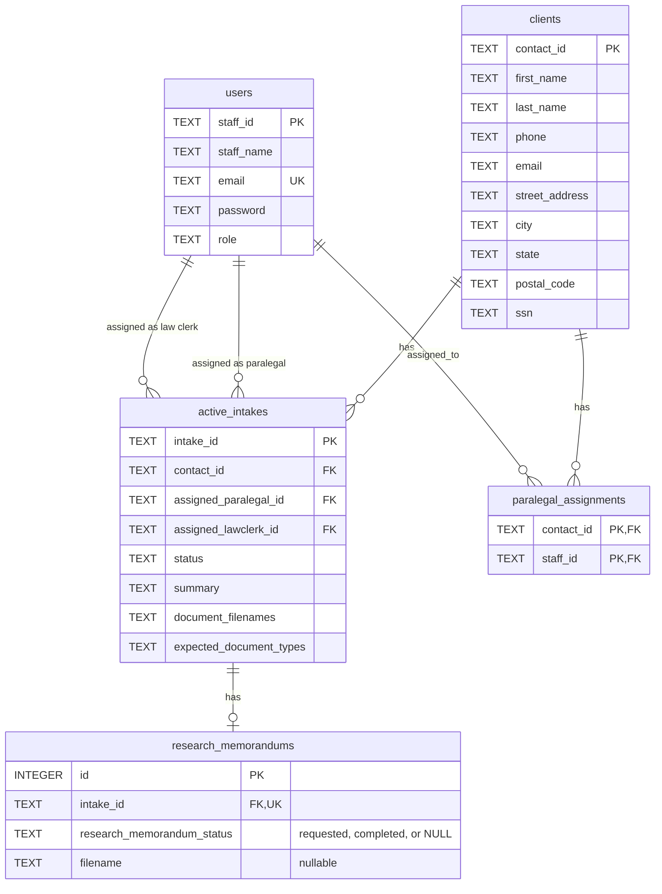

# Preliminary Legal Research Memorandum Demo

## Purpose

This planned demonstration shows how an immigration law office could use an AI-assisted application to prepare a preliminary research memorandum from an existing client intake. The application will bring together client information, an intake brief, supporting documents, and research from legal, news, and general web sources.

The memorandum will give the assigned paralegal an organized starting point to pass to an attorney. It will identify potentially relevant issues, explain what the research found, cite its sources, and identify missing information. The attorney remains responsible for evaluating the research and deciding how to proceed.

The application is the Spring Boot and Spring AI project in this folder, `legal-research`. The project already contains a small REST API, database access, and authentication. The memorandum workflow described here is the next feature to be built.

## Demonstration scenario

The sample database contains two fictional clients, Elena Rivera and Mateo Santos. Each has an active intake, an assigned paralegal, an assigned law clerk, and an associated research memorandum record.

Mateo's memorandum is marked `requested`, making his intake the initial demonstration case. Elena's memorandum has a `NULL` status and will not be selected for research.

Mateo has an employment-authorization application and a pending Maryland reckless-driving allegation. He also reports having diabetes and experiencing sudden confusion around the driving incident. He disputes the officer's account and says medical records and glucose-monitor data may be available, but those materials have not been supplied.

This combination gives the demonstration several connected subjects to explore: the immigration matter, the pending traffic matter, and the possible relevance of the reported medical circumstances. The application will preserve the distinction between documented facts, allegations, client statements, and unanswered questions.

## People and responsibilities

For memorandum preparation, the demo will use this convention:

| Responsibility | Source in the database | Mateo's assignment |
|---|---|---|
| Requestor | Intake's assigned paralegal | Riley Morgan |
| Provider/preparer | Intake's assigned law clerk | Doug Smith |
| Client | Client linked to the intake | Mateo Santos |

The database records staff identities and assignments. Treating the paralegal as requestor and the law clerk as provider is a demo convention; it is not a separate record of who actually submitted a request. The memorandum will also identify that its preparation was AI-assisted.

The assigned paralegal receives the preliminary work for review and subsequent attorney handoff. The application will not make legal decisions or represent the generated document as attorney-approved.

## Information already available

The SQLite schema and seed data are in `src/main/resources/schema.sql` and `src/main/resources/data.sql`.

| Table | Contribution to the demo |
|---|---|
| `research_memorandums` | Identifies the intake requiring research, tracks its status, and stores the resulting memorandum's filename. |
| `active_intakes` | Supplies the intake summary, document lists, and assigned paralegal and law clerk. |
| `clients` | Supplies the client's name, phone, email, and mailing address. |
| `users` | Supplies staff names, email addresses, roles, and credentials for application access. |
| `paralegal_assignments` | Retains the client-to-paralegal association. The memorandum workflow will use the assignments on the intake itself. |

Each memorandum belongs to one intake, and an intake can have at most one memorandum. A memorandum's status can be `requested`, `completed`, or `NULL`.

The resources folder also contains intake briefs and supporting source PDFs. Mateo's brief is `I-205-intake-brief.pdf`; his supporting documents include a USCIS receipt notice, a traffic citation, and a trial notice. The intake brief provides a summary, while the underlying documents provide source material for checking details.

Staff passwords and the client's SSN are not needed in the memorandum header or research input. The header will use the relevant staff and client contact information.

## Database structure

The database uses five tables. A primary key (PK) identifies a record, a foreign key (FK) links it to a record in another table, and a unique key (UK) prevents duplicate values. Identifiers such as `I-205` and `S-004` are stored as SQLite `TEXT`; the memorandum's `id` is an `INTEGER` primary key.

The diagram shows the relationships enforced by the current schema. A single bar at both ends means exactly one; a circle and crow's foot mean zero or many; a circle and bar mean zero or one.

### Keys, relationships, and constraints

| Table | Key and constraints | Relationship |
|---|---|---|
| `users` | `staff_id` is the primary key; `email` is unique. All columns are required. | One staff member can be assigned to multiple intakes or client assignments. |
| `clients` | `contact_id` is the primary key. All columns are required. | One client can have multiple active intakes and paralegal assignments. |
| `active_intakes` | `intake_id` is the primary key. All columns are required. | Each intake references exactly one client, one assigned paralegal, and one assigned law clerk. Both staff fields reference `users.staff_id`. |
| `research_memorandums` | `id` is the primary key. `intake_id` is required and unique. Status and filename are nullable. | Each memorandum references exactly one intake. The unique intake ID limits an intake to zero or one memorandum. |
| `paralegal_assignments` | The combination of `contact_id` and `staff_id` is the primary key; both are required foreign keys. | Links clients to staff without repeating names, roles, or email addresses. The same client/staff pair cannot occur twice. |

The foreign keys require referenced client, user, and intake records to exist. The application enables SQLite foreign-key enforcement on each database connection. No cascading deletes are configured: related records must be handled explicitly before a referenced record can be deleted.

The memorandum status has a database `CHECK` constraint allowing only `requested`, `completed`, or `NULL`. A `NULL` status means research has not been requested under the demo convention. The schema permits a nullable filename independently of the status; the planned application workflow will save the document and record the filename before marking the memorandum completed.

Staff roles currently use `paralegal` and `lawclerk`. The foreign keys validate staff identity, but do not check that a user assigned through `assigned_paralegal_id` actually has the paralegal role, or that an assigned law clerk has the lawclerk role. That distinction is an application responsibility. Likewise, the schema does not enforce agreement between `paralegal_assignments` and the paralegal assigned directly on an intake. Memorandum processing will use the intake assignments.

### Document storage and research selection

PDF contents are stored as project resource files, not inside SQLite. `document_filenames` and `expected_document_types` contain pipe-separated text lists retained from the sample data. The application will split those lists when processing them. The intake brief can be located using the existing `{intake_id}-intake-brief.pdf` convention; it is not listed in `document_filenames`.

The memorandum's `filename` will identify the saved research document. The schema currently stores no separate research-source records, citation records, request timestamps, or history of generated versions. References will be included in the generated document for the initial demonstration.

The database lookup will start at `research_memorandums`, filter for `research_memorandum_status = 'requested'`, and join to `active_intakes` and `clients`. It will join `users` twice: once through `assigned_paralegal_id` for the requestor and once through `assigned_lawclerk_id` for the provider/preparer. These joins assemble the header and intake context without duplicating staff contact information in the assignment tables.

The seed scripts insert users and clients before dependent records. Inserts skip existing primary-key values, allowing initialization to run repeatedly without duplicating records. They do not overwrite existing records, and `CREATE TABLE IF NOT EXISTS` does not migrate an older database structure.

## Planned workflow

1. **Find requested research.** Read memorandum records whose status is `requested`, and join each to its intake, client, and both assigned staff members.
2. **Assemble the header.** Identify the requestor, provider/preparer, client contact information, intake reference, and preparation date.
3. **Read the case background.** Use the client's intake brief and relevant supporting PDFs to assemble the known circumstances, allegations, important dates, and missing information.
4. **Develop preliminary research topics.** Identify the ordinary issues arising from the intake and any additional circumstances that warrant investigation. The precise instructions for formulating these topics will be designed later.
5. **Gather research.** Retrieve relevant legal authorities, news, and general web material, retaining source details for citations.
6. **Prepare the memorandum.** Organize the background, research questions, findings, sources, limitations, and possible follow-up into a readable document.
7. **Check the draft.** Check that factual statements match the supplied material and that cited sources support the research findings. Clearly identify uncertainty and missing evidence.
8. **Save and record the result.** Save the memorandum, record its filename, and change its status to `completed` after the document has been successfully saved.

For this workflow, `completed` will mean that the preliminary document has been generated and saved for review. It will not mean attorney approval. Because selection is limited to `requested`, completed memorandums will not be selected again during ordinary processing.

## What preliminary research means

This is broad initial research to help staff understand a matter and identify useful directions for attorney review. It does not require a fully developed legal question before processing begins.

For Mateo, topics could include the significance of the employment-authorization receipt, the alleged traffic offense, possible connections between the pending charge and his immigration matter, and how reported medical impairment might warrant further investigation.

Research could look for cases in which diabetes, hypoglycemia, or sudden impairment was raised in connection with driving allegations. It should explain the circumstances, evidence, reasoning, and outcomes of relevant cases, including unfavorable results and important differences from Mateo's situation. It should not assume that diabetes caused his alleged behavior or that similar arguments would succeed in his case.

Legal sources will support legal propositions. News may identify relevant developments, and general web sources may provide explanatory background, including medical context. These source categories will remain distinguishable. General medical information cannot establish what happened to Mateo, and a news account is not a substitute for the underlying legal authority.

The detailed research instructions, search approach, and source-selection rules remain to be designed.

## Planned memorandum contents

- **Header:** Requestor, provider/preparer, client name and contact information, intake ID, preparation date, and an AI-assisted preparation note.
- **Purpose and research topics:** A short explanation of what was investigated.
- **Case background:** Relevant intake facts, source documents, allegations, and client-reported circumstances.
- **Research findings:** Legal analysis and relevant background, with citations supporting the findings.
- **Missing information and limitations:** Facts or documents that remain unavailable and questions the research cannot resolve.
- **Suggested follow-up:** Issues and evidence for the paralegal and attorney to consider.
- **References:** Source titles, URLs, dates where available, and enough citation information to locate and check the material.

## Application approach

The application uses Spring Boot to expose REST endpoints, JDBC and `JdbcTemplate` to work with embedded SQLite, and Spring Security to authenticate staff against the `users` table. There is no graphical interface in this initial scope. REST clients supply email and password using HTTP Basic authentication, and the application uses stateless sessions.

Spring AI with OpenAI will support the AI-assisted research and drafting steps. The project already includes the OpenAI starter and reads its API key from `OPENAI_API_KEY`. PDF extraction, source retrieval, research instructions, citation checking, and document generation still need to be implemented. Adding the model dependency alone does not provide those capabilities.

The existing code separates the REST controller, service, repository, model, and security configuration into packages. The new workflow can follow that structure: the controller receives a request, the service coordinates the work, and database access retrieves the input and records the output.

The application is currently configured to use `jdbc:sqlite:legal-research.db`, a file relative to its working directory, and to initialize it with the SQL resources. The final memorandum format, output location, retrieval mechanism, and processing endpoint remain implementation decisions.

## Existing foundation and remaining work

Already present are the database definition and sample records, local PDFs, a GET endpoint for paralegal assignments, JDBC-backed authentication, and MockMvc integration tests covering authentication and access rules.

The next development stage will add requested-memorandum retrieval, assembly of the staff/client header, PDF reading, external research retrieval, AI-assisted drafting and checking, document saving, and the final status update.

## Demonstration boundaries

All client data and case documents are fictional. The demo assumes successful processing; error handling and retries are excluded for simplicity. Redaction is not considered for simplicity. Missing documents will be identified as limitations rather than automatically blocking preliminary research.

The result is a preliminary research document for staff and attorney review. Automated filing, client delivery, and attorney approval are outside this demonstration's scope.
